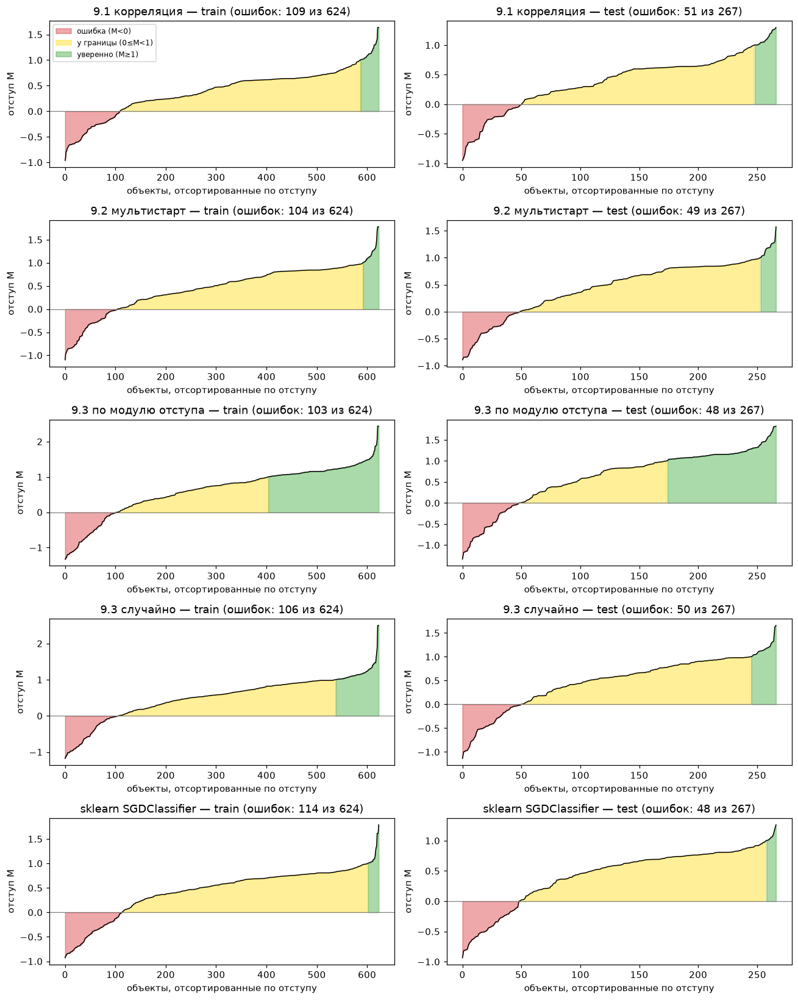
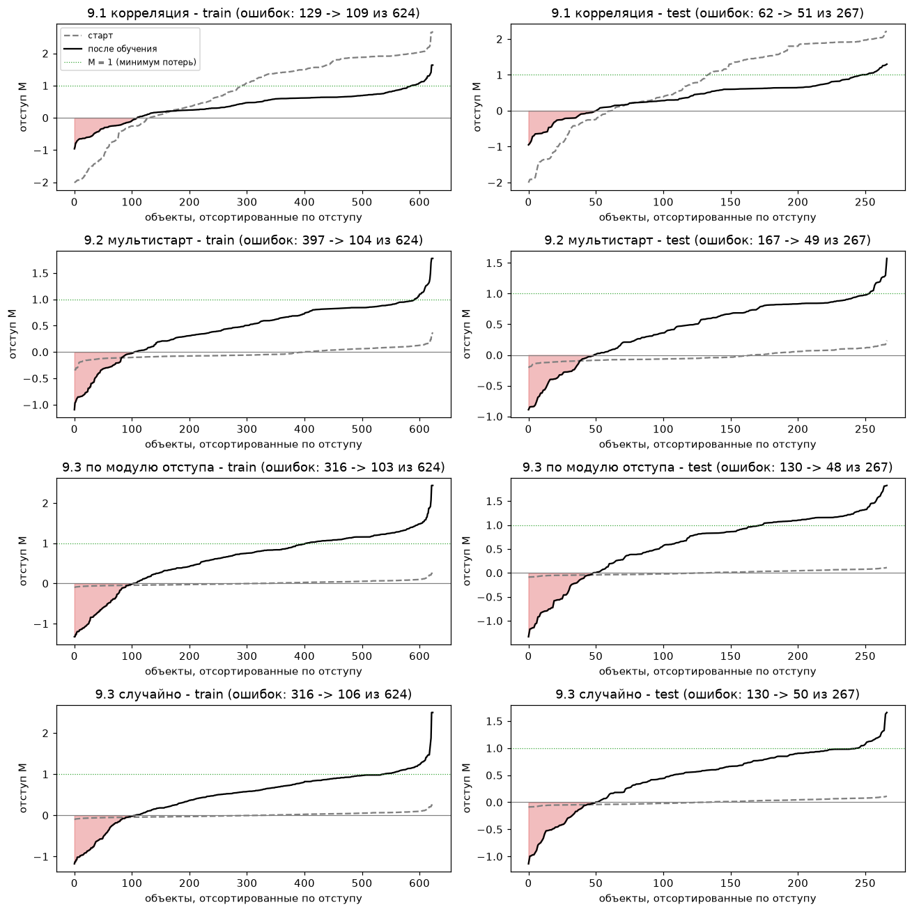
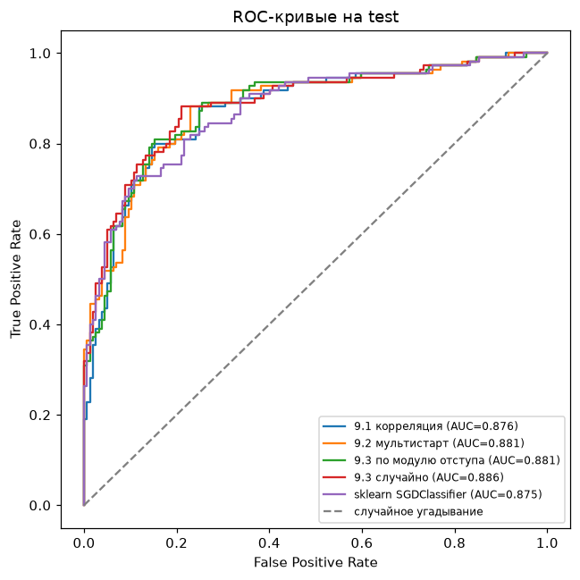
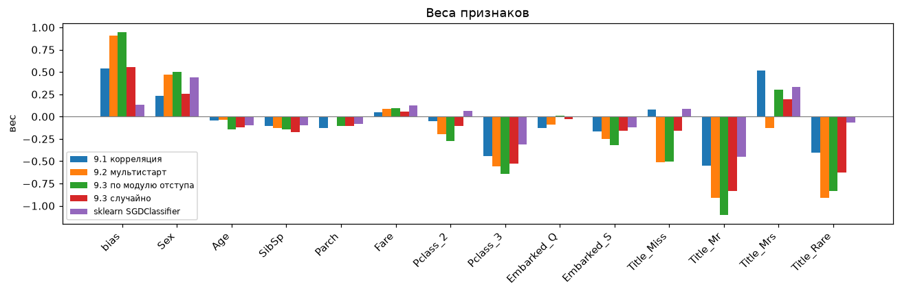

# Лабораторная работа №1. Линейная классификация

## Задание

В рамках лабораторной работы предстоит реализовать линейный классификатор и обучить его методом стохастического градиентного спуска с инерцией, L2-регуляризацией и квадратичной функцией потерь.

1. выбрать датасет для классификации;
2. реализовать вычисление отступа объекта (визуализировать, проанализировать);
3. реализовать вычисление градиента функции потерь;
4. реализовать рекуррентную оценку функционала качества;
5. реализовать метод стохастического градиентного спуска с инерцией;
6. реализовать L2-регуляризацию;
7. реализовать скорейший градиентный спуск;
8. реализовать предъявление объектов по модулю отступа;
9. обучить линейный классификатор на выбранном датасете;
   1. с инициализацией весов через корреляцию;
   2. со случайной инициализацией весов через мультистарт;
   3. со случайным предъявлением и с предъявлением по п. 8;
10. оценить качество классификации;
11. сравнить лучшую реализацию с эталонной;
12. подготовить отчет.

## Описание

Модель угадывает по данным пассажира «Титаника», выжил ли он. Это линейный классификатор, у каждого признака есть вес, баллы признаков складываются, и по знаку суммы выбирается ответ. Веса подбираются так, чтобы на известных пассажирах ошибок было как можно меньше. Для этого берется один случайный пассажир, и веса чуть сдвигаются против его ошибки (стохастический градиентный спуск).

**Общая сводка**

- Все пять методов дают на test accuracy 0.809–0.820, то есть различаются не больше чем на 3 пассажира из 267. Лучшая своя модель по accuracy на train (0.835) – 9.3 с предъявлением по модулю отступа. На test у нее accuracy **0.820**, F1 **0.767**, AUC **0.881**, у эталона `sklearn` 0.820 / 0.769 / 0.875. Результаты на уровне эталона.
- Около 82% – почти предел линейной модели на этих данных, примерно каждый шестой пассажир не угадывается никак (например, мужчины из 3-го класса, которые все же выжили).
- Главное, что пришлось поменять в алгоритме, это **не смешивать инерцию и скорейший спуск**. Длина шага скорейшего спуска подбирается для направления градиента, а при инерции мы идем по другому направлению. Поэтому сделаны два режима шага, а признаки `Age` и `Fare` **масштабируются**.

## Файлы

| файл | что внутри |
|---|---|
| `source/data_preprocessing.py` | подготовка данных, разбиение train/test, стандартизация |
| `source/model.py` | отступ, потери, градиент, оценка Q, L2, скорейший спуск, предъявление по отступу, SGD |
| `source/initialization.py` | стартовые веса и стартовое Q |
| `source/task.py` | эксперименты 9.1, 9.2, 9.3 |
| `source/metric.py` | accuracy, матрица ошибок, precision, recall, F1, ROC |
| `source/sklearn_baseline.py` | эталон |
| `source/report.py`, `source/main.py` | вывод таблиц и графиков, запуск всего |

---

## 1. Датасет

**Titanic** (Kaggle), 891 пассажир, нужно предсказать `Survived`. Погибли 549 человек (62%), выжили 342 (38%). Сильнее всего с исходом связаны пол (выжили 74% женщин и 19% мужчин) и класс билета (63%, 47% и 24% для 1-го, 2-го и 3-го классов).

**Обработка данных** в том порядке, в котором она выполняется в коде.

| шаг | зачем |
|---|---|
| ответы переведены в $-1$ (погиб) и $+1$ (выжил) | так определяется отступ (п. 2) |
| пол (`male` → 0, `female` → 1) | модель работает только с числами |
| из имени взято обращение (`Mr`, `Mrs`, `Miss`, `Master`) | обращение несет пол, возраст и статус |
| удалены `PassengerId`, `Ticket`, `Name`, `Cabin` | номера, имя уже использовано, у `Cabin` 77% пропусков |
| разбиение 70/30 (624 объекта в train, 267 в test) | test – «экзамен», модель его не видит |
| пропуски в `Embarked` заполнены самым частым значением по train, в `Age` медианой по train в группе (обращение, класс, пол) | 2 и 177 пропусков |
| редкие обращения объединены в `Rare` | по отдельности их слишком мало |
| `Pclass`, `Embarked`, `Title` разбиты на столбцы 0/1 с `drop_first=True` | см. ниже |
| добавлен столбец `bias` из единиц | свободный член модели |
| `Age` и `Fare` стандартизированы по формуле $x \to (x - \mu) / \sigma$, где $\mu$ и $\sigma$ считаются по train | см. ниже |

В итоге 14 признаков (`bias, Sex, Age, SibSp, Parch, Fare, Pclass_2, Pclass_3, Embarked_Q, Embarked_S, Title_Miss, Title_Mr, Title_Mrs, Title_Rare`). В test 110 выживших и 157 погибших.

**Сначала разбиение, потом статистики.** `load_data()` выполняет только действия над каждой строкой по отдельности. Затем `train_and_test()` делит выборку, `fit_imputer()` считает моду и медианы по train, а `apply_imputer()` применяет их и к train, и к test. Иначе в обучение попала бы информация о test, и оценка качества на нем была бы завышенной. Если у пассажира из test нет пары в train по группе (обращение, класс, пол), возраст берется по более крупной группе (класс, пол), а если нет и ее, то общая медиана по train. Список допустимых классов, портов и обращений задан заранее, поэтому столбцы 0/1 в train и test всегда одинаковые (`build_features()`).

**Зачем `drop_first`.** Если оставить все три столбца `Pclass_1`, `Pclass_2`, `Pclass_3`, их сумма у любого пассажира равна 1, то есть совпадает со столбцом `bias`. Тогда одинаково хорошее решение можно записать бесконечным числом способов, и веса теряют смысл (у нас получалось, что 1-й класс «хуже» 2-го). Это мультиколлинеарность из лекции. Удалены базовые категории `Pclass_1`, `Embarked_C`, `Title_Master`, веса остальных читаются как отличие от них.

**Зачем стандартизация.** Градиент пропорционален значениям признака. У `Fare` значения до 512, у остальных признаков 0 или 1, поэтому вес `Fare` дергался в сотни раз сильнее. Среднее и разброс считаются только по train, test масштабируется теми же числами (`standardize()`).

---

## 2. Отступ объекта

Модель выдает балл $\langle w, x\rangle$. Отступ – это балл, умноженный на правильный ответ, то есть $M_i = y_i \langle w, x_i\rangle$. Если $M > 0$, модель права, если $M < 0$, ошибается, а чем больше модуль, тем увереннее ответ. Это как ставка на матч, чем увереннее и точнее угадан исход, тем больше отступ.

Отступ считает `calculate_margin()`, график строит `plot_margins()`. Объекты отсортированы по отступу слева направо. Красная зона – ошибки, желтая – верно, но у границы ($0 \le M < 1$), зеленая – уверенно верно ($M \ge 1$).

| метод | ошибок на train (из 624) | ошибок на test (из 267) |
|---|---|---|
| 9.1 корреляция | 109 | 51 |
| 9.2 мультистарт | 104 | 49 |
| 9.3 по модулю отступа | **103** | **48** |
| 9.3 случайно | 106 | 50 |
| sklearn | 114 | **48** |

**Что видно на графике.**

- Ошибается примерно каждый шестой. На train и test доля ошибок почти одинаковая (у 9.2 16.7% и 18.4%), значит сильного переобучения нет.
- Кривая у большинства методов прижимается к уровню $M \approx 1$, зеленой зоны мало. Так и должно быть при квадратичных потерях, их минимум ровно в единице, и за «слишком уверенные» ответы ($M > 1$) модель тоже штрафуется.
- Левый «хвост» – пассажиры, на которых модель ошибается с большим отрицательным отступом. Это нетипичные люди (например, мужчины 3-го класса, которые выжили). Линейная модель такого угадать не может.
- Ступеньки на кривой – группы пассажиров с одинаковыми признаками, у них одинаковый балл.
- У 9.3 по модулю отступа зеленая зона самая широкая, и ошибок меньше всех на train (103) и вместе с `sklearn` на test (48).

### Отступы до и после обучения

Серый пунктир – отступы при стартовых весах, черная линия – после обучения.

| метод | ошибок на train | ошибок на test |
|---|---|---|
| 9.1 корреляция | 129 → 109 | 62 → 51 |
| 9.2 мультистарт | 397 → 104 | 167 → 49 |
| 9.3 по модулю отступа | 316 → 103 | 130 → 48 |
| 9.3 случайно | 316 → 106 | 130 → 50 |

- **Случайный старт** (9.2, 9.3). Стартовые веса крошечные, поэтому баллы у всех объектов около нуля и ошибок от половины до двух третей. Обучение «раздувает» отступы и сокращает ошибки в 3–4 раза.
- **Корреляционный старт** (9.1) устроен наоборот. Он сразу хорош, но «перегрет». У 53% объектов $M > 1$, у 56 пассажиров уверенная ошибка ($M < -1$). Причина – признаки пересекаются (`Sex` и `Title_Mrs` описывают одно и то же), и их вклады складываются с повторами. Если просто уменьшить все стартовые веса в 2.3 раза, accuracy не изменится, а средняя потеря упадет с 1.25 до 0.64. Обучение делает то же самое и даже лучше, потеря падает до 0.57, а уверенных ошибок не остается совсем.

---

## 3. Градиент функции потерь

Потеря – штраф за ошибку на одном объекте, $\mathcal{L}(M) = (1 - M)^2$, ноль при $M = 1$. Градиент показывает, в какую сторону сдвигать веса, чтобы штраф рос быстрее всего, а мы идем в обратную сторону. Как нащупать ногой склон в тумане и идти вниз.

$$\nabla_w \mathcal{L} = -2 (1 - M_i) y_i x_i$$

Потеря считается в `calculate_loss()`, градиент в `calculate_gradient()`. Из формулы следует, что если $M_i = 1$, градиент нулевой, исправлять нечего. Если признак объекта равен нулю, его вес не меняется. Если признак большой, поправка к его весу тоже большая, поэтому нужна стандартизация (п. 1).

**Почему не считать число ошибок напрямую.** Оно меняется скачками, и градиент почти везде нулевой. Гладкая потеря всегда не меньше счетчика ошибок, поэтому, уменьшая ее, мы уменьшаем и число ошибок.

---

## 4. Рекуррентная оценка функционала качества

Нужно следить, хорошо ли идет обучение. Честная оценка – средняя потеря по всей выборке, но считать ее на каждом шаге слишком долго. Поэтому оценка $Q$ обновляется «на ходу» в `calculate_q()`.

$$Q := \lambda \xi_i + (1 - \lambda) Q$$

Здесь $\xi_i$ – потеря на текущем объекте. Это как средний балл за последнее время, свежая оценка весит больше, старые постепенно «выцветают». Число $\lambda$ – темп забывания, $Q$ усредняет примерно $1/\lambda$ последних объектов. У нас $\lambda = 0.001$ (около 1000 объектов, полторы эпохи), лекция рекомендует брать $\lambda$ порядка $1/m$, у нас $m = 624$. Стартовое $Q$ – средняя потеря на 50 случайных объектах (`calculate_q_start()`).

**Проблема.** С $\lambda = 0.1$ (память около 10 объектов) $Q$ прыгал в 3 раза при неизменной модели, и по нему нельзя было понять, когда остановиться.

**Когда останавливаться.** Раз в эпоху (624 шага) $Q$ сравнивается с его значением эпоху назад. Если изменение не больше `tolerance` три эпохи подряд, обучение заканчивается, страховочный лимит – $10^5$ шагов. Сравнивать соседние шаги нельзя, их разница зависит от одного случайного объекта и срабатывала случайно.

---

## 5. SGD с инерцией

Обычный градиентный спуск на каждый шаг обходит всю выборку. Стохастический берет **одного случайного пассажира**, смотрит на его ошибку и сразу чуть поправляет веса. Это как учиться стрелять, берешь случайный выстрел и подправляешь прицел, не дожидаясь тысячи выстрелов.

Один шаг в `calculate_sgd()` состоит из выбора объекта, расчета отступа, потери и градиента, добавления штрафа L2, вычисления шага и обновления весов и $Q$.

**Инерция** помнит прошлое движение, как тяжелая тележка. Мелкие кочки (шум отдельных объектов) ее не останавливают, а устойчивое направление разгоняет.

$$v := \gamma v + h g, \qquad w := w - v$$

Здесь $g$ – градиент потери со штрафом, $\gamma$ (`momentum`, у нас 0.5) – какая доля прошлой скорости сохраняется, $h$ – длина шага. В режиме `constant` (`step="constant"`) она постоянная, $h$ равна `learning_rate`. В лекции перед градиентом стоит множитель $(1 - \gamma)$, у нас его нет, это та же инерция в другом масштабе шага.

---

## 6. L2-регуляризация

К потере добавляется штраф за большие веса, $\frac{\tau}{2}\lVert w\rVert^2$. Градиент штрафа равен $\tau w$ и «тянет» все веса к нулю. Чем проще объяснение, тем лучше, модели с огромными весами разных знаков подгоняются под шум в данных (переобучение).

Штраф считает `calculate_l2()`, $\tau = 0.001$ (слабая регуляризация). Вес `bias` не штрафуется, это не зависимость от признака, а базовая склонность модели.

---

## 7. Скорейший градиентный спуск

Направление шага уже выбрано, это антиградиент потери со штрафом $g = \nabla \mathcal{L} + \tau w$. Остается решить, как далеко по нему идти. Скорейший спуск выбирает длину шага $h$ так, чтобы значение потери вместе со штрафом после шага было наименьшим.

$$\varphi(h) = (1 - M(w - h g))^2 + \frac{\tau}{2}\lVert \tilde{w} - h \tilde{g}\rVert^2 \to \min_h$$

Здесь $\tilde{w}$ и $\tilde{g}$ – веса и градиент без компоненты `bias`, ее не штрафуем. Функция $\varphi(h)$ – парабола, поэтому ее минимум находится из условия $\varphi'(h) = 0$ в явном виде.

$$h^{\ast} = \frac{\langle g, g\rangle}{2\langle g, x\rangle^2 + \tau \langle \tilde{g}, \tilde{g}\rangle}$$

Шаг считает `calculate_h()`. Из формулы следует несколько вещей.

- Шаг всегда неотрицательный. Числитель – квадрат длины градиента, знаменатель – сумма двух неотрицательных слагаемых. Если градиент нулевой, шаг считается равным нулю.
- Штраф учтен. В знаменателе есть слагаемое с $\tau$, поэтому шаг получается чуть короче, чем без регуляризации.
- Если $\tau = 0$, формула превращается в $1/(2\lVert x\rVert^2)$, и после такого шага отступ объекта становится ровно 1. Лекция приводит для этого случая $\lVert x\rVert^{-2}$, разница в множителе 2 из производной $(1 - M)^2$.

Проверка на 3000 случайных объектах при $\tau = 0.001$, $0.1$ и $1$ показала, что отрицательных шагов нет, а найденное $h$ действительно минимум $\varphi(h)$.

**Проблема 1. Нельзя идти на весь шаг.** Идеальный шаг для одного объекта плох для всех. Модель подгоняется под очередного пассажира и «забывает» остальных, как учитель, который перестраивает весь урок под каждого, кто задал вопрос. Accuracy на train при этом скакала примерно от 0.4 до 0.8 в зависимости от того, какие объекты попались последними. Поэтому в режиме `steepest` берется доля шага, $h = \eta h^{\ast}$, у нас $\eta = 0.01$ (`step_fraction`). Этого приема в лекции нет, это наше решение.

**Проблема 2. Скорейший спуск нельзя смешивать с инерцией.** Длина $h^{\ast}$ подобрана для направления $g$, а при инерции мы идем по другому направлению $v = \gamma v_{prev} + h g$. Шаг оптимален для одной дороги, а идем по другой. На 20 тысячах шагов при $\gamma = 0.5$ в 9.5% шагов реальное направление вообще не уменьшало потерю текущего объекта, при $\gamma = 0.9$ в 27%. Поэтому режимы разделены.

| режим | длина шага | инерция | что делаем с весами |
|---|---|---|---|
| `constant` | постоянная, `learning_rate` | да, $\gamma$ | $v := \gamma v + h g$, $w := w - v$ |
| `steepest` | $h = \eta h^{\ast}$, свой для каждого объекта | нет | $w := w - h g$ |

Основной режим для обучения (п. 9) – `constant`, потому что задание просит обучить классификатор SGD с инерцией. Режим `steepest` показан на сравнении двух режимов из одного стартового вектора (корреляция).

| режим | accuracy train | accuracy test | шагов |
|---|---|---|---|
| `constant` | 0.829 | 0.813 | 89 856 |
| `steepest` | 0.796 | 0.809 | 8 736 |

На test режимы почти не различаются (разница в 1 пассажира из 267). `steepest` останавливается в 10 раз раньше, но на train получается хуже, а `constant` учится дольше и подгоняется лучше.

---

## 8. Предъявление объектов по модулю отступа

Вместо равновероятного выбора объект выбирается с вероятностью

$$p_i \propto \frac{1}{\lvert M_i\rvert + \epsilon}$$

Чем ближе объект к границе классов (маленький модуль отступа), тем чаще он попадает в обучение. Как репетитор, который чаще дает задачи, в которых ученик «плавает». Малое $\epsilon$ защищает от деления на ноль. Вероятности пересчитываются раз в 100 шагов, потому что пересчет по всей выборке дорогой (`calculate_p()`, режим `sampling="margin"`).

---

## Подбор гиперпараметров

`learning_rate` и `tolerance` подобраны перебором, 5 значений шага на 4 значения `tolerance`, для каждой пары все 4 метода обучения по 3 seed. Выбирали по accuracy **на train**. Test в подборе не участвовал, иначе мы подогнали бы настройки под него, и он перестал бы быть честной проверкой.

| `learning_rate` | `tolerance` | train, среднее | train, худший–лучший | шагов в среднем |
|---|---|---|---|---|
| 0.004 | 0.01 | 0.813 | 0.740–0.835 | 28.1 тыс. |
| 0.002 | 0.003 | 0.836 | 0.825–0.848 | 80.0 тыс. |
| **0.002** | **0.01** | **0.825** | **0.803–0.833** | **17.7 тыс.** |
| 0.002 | 0.03 | 0.825 | 0.801–0.833 | 6.5 тыс. |
| 0.001 | 0.003 | 0.833 | 0.825–0.841 | 86.3 тыс. |
| 0.001 | 0.01 | 0.824 | 0.806–0.837 | 21.6 тыс. |
| 0.0005 | 0.01 | 0.822 | 0.803–0.835 | 15.0 тыс. |
| 0.0003 | 0.01 | 0.825 | 0.809–0.841 | 21.4 тыс. |

- Слишком большой шаг (0.004) неустойчив, один из запусков провалился до 0.740.
- Шаги от 0.0003 до 0.002 при `tolerance = 0.01` дают почти одинаковое среднее (0.822–0.825).
- Меньшая `tolerance = 0.003` дает среднее выше на 0.007–0.014 у всех шагов, но шагов в 4–5 раз больше (80–90 тыс., почти до лимита в 100 тыс.). При `tolerance = 0.001` обучение почти всегда упирается в лимит, критерий остановки не срабатывает.
- Выбраны `learning_rate = 0.002` и `tolerance = 0.01`, более быстрый вариант. Цена выбора – среднее на 0.011 ниже, чем у лучшей строки, зато в 4–5 раз меньше шагов.
- Доля шага $\eta = 0.01$ режима `steepest` не перебиралась, она взята из предварительных запусков и нужна только для сравнения режимов в п. 7.

| параметр | значение | что это |
|---|---|---|
| `learning_rate` | 0.002 | длина шага в режиме `constant` |
| `step_fraction` $\eta$ | 0.01 | доля от шага скорейшего спуска в режиме `steepest` |
| `tolerance` | 0.01 | порог изменения $Q$ за эпоху для остановки |
| `q_update_rate` $\lambda$ | 0.001 | темп забывания в $Q$ |
| `momentum` $\gamma$ | 0.5 | инерция |
| `l2_strength` $\tau$ | 0.001 | сила L2 |
| `n_starts` | 5 | число запусков в мультистарте |

---

## 9. Обучение

Все методы обучаются в режиме `constant` (инерция с постоянным шагом) с одними и теми же значениями гиперпараметров из предыдущего раздела.

### 9.1. Инициализация весов через корреляцию

Каждый признак оценивается сам по себе, смотрим, насколько он связан с ответом (`calculate_w_correlation()`).

$$w_j = \frac{\langle y, f_j\rangle}{\langle f_j, f_j\rangle}$$

Для признака 0/1 это просто **средний ответ среди объектов, у которых признак есть**. Например, у `Sex` вес 0.455, потому что среди женщин в среднем исход ближе к $+1$. Знаменатель делает вес независимым от единиц измерения (годы или месяцы).

**Проблема.** Это точное решение метода наименьших квадратов, но только если признаки не зависят друг от друга. У нас они сильно перекрываются, поэтому это хороший старт, а не конечный ответ. Accuracy на test до всякого обучения уже 0.768. Так как стартовая точка близка к решению, 9.1 останавливается за 5.6 тыс. шагов, остальные методы за 14–55 тыс.

### 9.2. Случайная инициализация и мультистарт

Веса берутся случайными и маленькими, из $U(-\tfrac{1}{2n}, \tfrac{1}{2n})$ (`calculate_w_random()`). Обучение запускается 5 раз с разных стартов (`run_multistart()`), выбирается запуск с лучшей accuracy **на train**. Это как пять попыток штурма горы с разных троп, одна может упереться в скалу.

Accuracy на train по запускам составила 0.824, **0.833**, 0.825, 0.824, 0.811. Результаты близки, так как после масштабирования признаков обучение слабо зависит от стартовых весов. Ось на графике начинается примерно с 0.76, поэтому разброс выглядит сильнее, чем есть (разница лучшего и худшего всего около 14 объектов).

### 9.3. Случайное предъявление и по модулю отступа

Оба варианта стартуют с **одних и тех же** случайных весов, поэтому разница объясняется только способом выбора объектов (`run_sampling_comparison()`).

| | accuracy train | accuracy test | precision | recall | шагов |
|---|---|---|---|---|---|
| случайно | 0.830 | 0.813 | 0.849 | 0.664 | 16 848 |
| по модулю отступа | 0.835 | 0.820 | 0.823 | 0.718 | 13 728 |

Варианты близки. Предъявление по отступу чуть лучше на test (0.820 против 0.813, 2 пассажира из 267), сходится чуть быстрее (13.7 тыс. шагов против 16.8 тыс.) и меньше пропускает выживших (recall 0.718 против 0.664), но ценой чуть меньшей точности (precision 0.823 против 0.849). Разрыв между train и test почти одинаковый, 0.017 у случайного предъявления и 0.015 у предъявления по отступу, то есть переобучения на пограничных объектах не видно. Разница в 2 ошибки получена на одном разбиении, поэтому выигрыш предъявления по отступу в этой работе не доказан, но и вреда от него нет.

---

## 10. Оценка качества классификации

Все метрики, кроме `acc train`, считаются на test.

| метод | acc train | acc test | precision | recall | F1 | AUC | итераций |
|---|---|---|---|---|---|---|---|
| 9.1 корреляция | 0.825 | 0.809 | 0.792 | 0.727 | 0.758 | 0.876 | 5 616 |
| 9.2 мультистарт | 0.833 | 0.816 | 0.785 | **0.764** | **0.774** | 0.881 | 54 912 |
| 9.3 по модулю отступа | **0.835** | **0.820** | 0.823 | 0.718 | 0.767 | 0.881 | 13 728 |
| 9.3 случайно | 0.830 | 0.813 | **0.849** | 0.664 | 0.745 | **0.886** | 16 848 |
| sklearn | 0.817 | **0.820** | 0.816 | 0.727 | 0.769 | 0.875 | 42 эпохи |

Лучшей своей моделью считаем ту, у которой выше accuracy на train, это 9.3 по модулю отступа. По test все методы различаются на 3 пассажира (0.809–0.820), так что на этом разбиении нельзя уверенно сказать, что какой-то из них лучше.

**Как читать метрики.** Метрики посчитаны своими функциями из `metric.py`.
- **accuracy** – доля верных ответов (`calculate_accuracy()`). Погибших 62%, поэтому «всем отвечать погиб» дало бы 0.59, и одной accuracy мало.
- **precision** – когда модель говорит «выжил», как часто права (`calculate_precision()`).
- **recall** – какую долю выживших нашла (`calculate_recall()`).
- **F1** – одно число из двух предыдущих, высокое только если оба высокие (`calculate_f1()`).
- **AUC** – вероятность, что случайный выживший получит балл выше случайного погибшего, 0.5 – угадывание, 1 – идеально (`calculate_roc()`).

Строки – правда, столбцы – ответ модели. У всех методов выживших «хоронят» чаще, чем наоборот. Самый осторожный вариант – 9.3 случайно, у него 37 пропущенных выживших (recall 0.664) и всего 13 ложных тревог (precision 0.849). Самый «щедрый» – 9.2, 26 пропущенных и 23 ложные тревоги.

Модель выдает балл, и порог «с какого балла отвечать выжил» можно двигать. Каждая точка кривой соответствует одному порогу, по X доля погибших, ошибочно названных выжившими, по Y доля найденных выживших. Чем ближе к левому верхнему углу, тем лучше. Кривые всех методов почти совпадают (AUC 0.875–0.886) и одинаково хорошо упорядочивают пассажиров.

### Анализ весов

Вес – это вклад признака в балл. Положительный сдвигает ответ к «выжил», отрицательный к «погиб». Веса сравнимы между собой, потому что `Age` и `Fare` стандартизированы (вес показывает эффект на одно стандартное отклонение, то есть около 13 лет и 51 фунта). Веса столбцов `Pclass`, `Embarked`, `Title` – это отличие от базы (`Pclass_1`, `Embarked_C`, `Title_Master`). Столбец `bias` – это балл «базового» пассажира, мальчика (`Master`) 1-го класса из Cherbourg, без родственников, среднего возраста, со средним билетом.

Веса лучшей своей модели (9.3 по модулю отступа) приведены ниже.

| признак | вес | что значит |
|---|---|---|
| `bias` | +0.94 | базовый пассажир скорее выжил |
| `Sex` | +0.50 | женщины выживали чаще |
| `Age` | −0.14 | старше на 13 лет – шанс ниже |
| `SibSp` | −0.15 | каждый брат/сестра/супруг на борту снижает шанс |
| `Parch` | −0.11 | каждый родитель/ребенок на борту немного снижает шанс |
| `Fare` | +0.09 | дороже билет – выше шанс |
| `Pclass_2` | −0.28 | 2-й класс хуже 1-го |
| `Pclass_3` | −0.64 | 3-й класс заметно хуже 1-го |
| `Embarked_Q` | +0.01 | примерно как Cherbourg |
| `Embarked_S` | −0.32 | Southampton хуже Cherbourg |
| `Title_Miss` | −0.51 | см. ниже |
| `Title_Mr` | **−1.10** | взрослые мужчины – самый сильный минус |
| `Title_Mrs` | +0.30 | замужние женщины |
| `Title_Rare` | −0.84 | редкие обращения, в основном мужчины-офицеры, священники, доктора |

**Два примера расчета** (балл = bias + вклады признаков).
- Мужчина `Mr`, 3-й класс, Southampton, дешевый билет ($-0.5\sigma$) получает $0.94 - 0.64 - 1.10 - 0.32 - 0.05 \approx -1.17$, ответ «погиб».
- Женщина `Mrs`, 1-й класс, Cherbourg, дорогой билет ($+1\sigma$) получает $0.94 + 0.50 + 0.30 + 0.09 \approx +1.83$, ответ «выжила».

**Что устойчиво.** Знаки `bias`, `Sex`, `Age`, `SibSp`, `Fare`, `Pclass_3`, `Embarked_S`, `Title_Mr`, `Title_Rare` одинаковы у всех пяти моделей, включая `sklearn`. Это главные факторы выживания, и они совпадают с историей («женщины и дети первыми», 1-й класс ближе к шлюпкам).

**Что нестабильно.** Веса `Pclass_2`, `Embarked_Q`, `Title_Miss` и `Title_Mrs` различаются между методами даже по знаку (например, у `Title_Miss` +0.08 у 9.1 и у sklearn, −0.51 у 9.2 и у 9.3 по отступу, у `Title_Mrs` от −0.13 у 9.2 до +0.51 у 9.1), при почти одинаковом качестве. Причина в том, что признаки пересекаются, `Miss` и `Mrs` всегда означают `Sex = 1`, а `Mr` – `Sex = 0`. Одно и то же предсказание получается разными комбинациями весов, и SGD приходит к одной из них в зависимости от старта. Поэтому сравнивать лучше итоговый балл типичного пассажира, а не отдельный вес.

---

## 11. Сравнение с эталоном

Эталон – `SGDClassifier` из `sklearn` в тех же условиях (`loss='squared_error'`, `penalty='l2'` с тем же коэффициентом, `fit_intercept=False`, bias уже в данных). С шагом по умолчанию веса `sklearn` расходились до $10^{12}$, поэтому темп обучения подобран отдельно (`learning_rate='adaptive'`, `eta0=0.001`). Числа `learning_rate` и `eta0` напрямую не сравнить, у нас это постоянная длина шага вместе с инерцией, у `sklearn` начальный шаг с автоматическим уменьшением и без инерции.

| | accuracy test | F1 | AUC |
|---|---|---|---|
| **9.3 по модулю отступа** (наша лучшая) | 0.820 | 0.767 | **0.881** |
| sklearn | 0.820 | **0.769** | 0.875 |

Наша реализация на уровне эталона. По accuracy результат одинаковый, по F1 и AUC разница меньше 0.01. Это статистически ничего не доказывает, поэтому обоснованный вывод такой, что качество не хуже.

---

## Выводы

- Скорейший спуск нельзя смешивать с инерцией. Длина шага подбирается для направления градиента, а при инерции идем по другому направлению. Сделаны два режима шага, обучение идет в режиме `constant`, скорейший спуск показан отдельным сравнением.
- Полный шаг скорейшего спуска подгоняет веса под последний объект, и результат скачет. В режиме `steepest` берется доля шага (1%).
- Шаг скорейшего спуска считается с учетом штрафа L2 и всегда неотрицательный, без штрафа формула превращается в прежнюю.
- Пропуски заполняются статистиками только по train, разбиение идет до них, иначе информация о test попадает в обучение.
- Признаки надо масштабировать, иначе `Fare` перетягивает обучение на себя.
- Лишние столбцы (`Pclass_1 + Pclass_2 + Pclass_3 = bias`) убрал через `drop_first`, после этого веса стали осмысленными.
- Остановку по $Q$ пришлось проверять раз в эпоху, по соседним шагам она срабатывала случайно.
- Все методы близки (accuracy на test 0.809–0.820, разница до 3 пассажиров). Корреляционный старт, мультистарт и оба способа предъявления объектов на этом разбиении неразличимы. Своя реализация на уровне `sklearn`.
- Линейная модель упирается примерно в 0.82. Веса сходятся с тем, что известно о катастрофе, главное – пол и класс билета.
