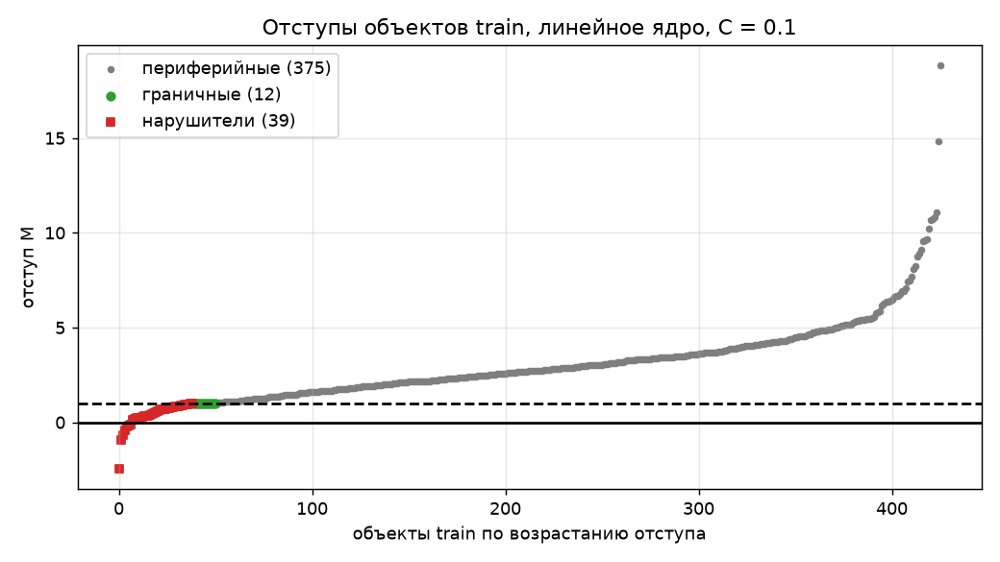
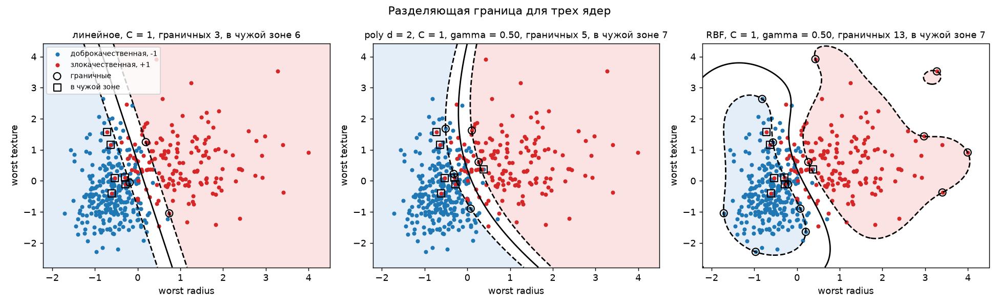
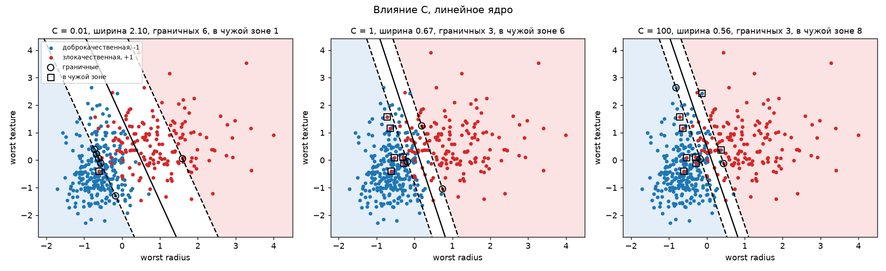
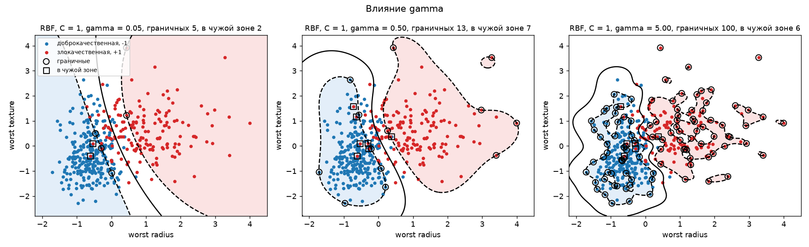

# Лабораторная работа №3. SVM

## Задание

В рамках лабораторной работы предстоит реализовать SVM и сравнить с эталонной реализацией алгоритма.

1. выбрать датасет для бинарной классификации;
2. реализовать решение двойственной задачи по лямбда; для решения задачи использовать scipy.optimize.minimize или любую другую библиотеку;
3. провернуть трюк с ядром;
4. построить линейный классификатор;
5. визуализировать решение;
6. сравнить с эталонным решением;

## Описание

По результатам анализа клеток опухоли нужно определить, злокачественная она или доброкачественная. SVM ищет разделяющую поверхность с самой широкой полосой между классами. Объекты, которые лежат на краю полосы или заходят в нее, называются опорными, и только они определяют решение. Трюк с ядром позволяет строить нелинейные границы, не вычисляя новые признаки явно.

**Общая сводка**

- Датасет Breast Cancer Wisconsin, 569 опухолей, 30 признаков, злокачественных 37 %.
- Двойственная задача решается `scipy.optimize.minimize` (метод SLSQP) с аналитическим градиентом. Число опорных объектов, $w_0$ и предсказания совпадают с `SVC` из `sklearn` для всех трех ядер.
- Реализованы линейное, полиномиальное и RBF ядра. Предсказание и $w_0$ считаются только через матрицу ядра, без вектора $w$.
- Параметры $C$ и $\gamma$ выбраны на валидационной части train. Точность на test у линейного ядра 0.979, у полиномиального и RBF 0.965. Данные почти линейно разделимы, поэтому нелинейные ядра не дают выигрыша.

## Файлы

| файл | что внутри |
|---|---|
| `source/data_preprocessing.py` | загрузка датасета, метки $\pm 1$, разбиение train/test, стандартизация |
| `source/model.py` | ядра, функция двойственной задачи и ее градиент, решение через `minimize`, $w$, $w_0$, предсказание |
| `source/metric.py` | точность, отступы, типы объектов по $\lambda$ |
| `source/sklearn_baseline.py` | эталонный `SVC` и сравнение с ним |
| `source/plots.py` | разделяющие границы на двух признаках и график отступов |
| `source/main.py` | запуск всех пунктов и вывод результатов, флаги `RUN_SELECTION`, `RUN_PLOTS`, `RUN_SKLEARN` |

---

## 1. Выбор датасета

Выбран датасет **Breast Cancer Wisconsin** из `sklearn`. Это 569 опухолей и 30 признаков клеток (радиус, текстура, площадь и другие), посчитанных по снимку.

Датасет подходит для SVM по трем причинам.
1. Задача бинарная, злокачественная опухоль (+1) или доброкачественная (−1).
2. Классы почти разделяются плоскостью, но не идеально. Так видно все три типа объектов, в том числе нарушителей.
3. Признаки числовые и без пропусков.

**Обработка данных**

| шаг | пометки |
|---|---|
| метки переведены в $+1$ (злокачественная) и $-1$ (доброкачественная) | в `sklearn` злокачественная обозначена 0 |
| разбиение 75/25 (426 и 143 опухоли, seed 42) со стратификацией | доля злокачественных в обеих частях одинаковая (0.373 и 0.371) |
| стандартизация `StandardScaler`, среднее и std только по train | признаки в разных масштабах, а SVM считает расстояния и скалярные произведения |
| столбец из единиц не добавляется | свободный член $w_0$ в SVM ищется отдельно |

---

## 2. Решение двойственной задачи по λ

### 2.1. Постановка

Линейный классификатор $a(x) = \mathrm{sign}(\langle w, x \rangle - w_0)$. Отступ объекта $M_i = y_i(\langle w, x_i \rangle - w_0)$ положительный, если ответ верный, и тем больше, чем увереннее модель.

Ширина полосы между классами равна $2 / \|w\|$, если нормировать $w$ так, чтобы у ближайших объектов было $M = 1$. Широкая полоса – это малый $\|w\|$. Классы в реальных данных пересекаются, поэтому объектам разрешено заходить в полосу на величину $\xi_i$, но за это штрафуют (мягкий зазор).

$$\frac{1}{2}\|w\|^2 + C \sum_{i=1}^{\ell} \xi_i \to \min_{w, w_0, \xi}, \qquad M_i \ge 1 - \xi_i, \quad \xi_i \ge 0$$

Это то же самое, что минимизировать hinge loss $(1 - M_i)_+$ с регуляризацией. $C$ задает компромисс между шириной полосы и штрафом за нарушителей.

### 2.2. Двойственная задача

Из условий Каруша-Куна-Таккера следует $w = \sum \lambda_i y_i x_i$, $\sum \lambda_i y_i = 0$ и $0 \le \lambda_i \le C$. Если подставить это в функцию Лагранжа, остается задача только по $\lambda$.

$$-\mathcal{L}(\lambda) = -\sum_{i=1}^{\ell} \lambda_i + \frac{1}{2} \sum_{i=1}^{\ell} \sum_{j=1}^{\ell} \lambda_i \lambda_j y_i y_j \langle x_i, x_j \rangle \to \min_{\lambda}, \qquad \sum_{i=1}^{\ell} \lambda_i y_i = 0, \quad 0 \le \lambda_i \le C$$

Объекты входят в задачу только через скалярные произведения, то есть через матрицу Грама $K_{ij} = \langle x_i, x_j \rangle$ размера 426 × 426. В коде $v = \lambda \circ y$, тогда функция и ее градиент

$$-\mathcal{L}(\lambda) = -\sum \lambda_i + \frac{1}{2} \sum_{i,j} v_i v_j K_{ij}, \qquad \nabla = y \circ (K v) - 1$$

Таблица $v_i v_j$ считается через `np.outer(v, v)`.

### 2.3. Решение через `scipy.optimize.minimize`

| параметр | значение | зачем |
|---|---|---|
| `method` | `"SLSQP"` | единственный быстрый метод, который поддерживает и границы, и ограничение-равенство |
| `x0` | нули | допустимая точка, $\sum \lambda_i y_i = 0$ выполняется |
| `jac` | аналитический градиент | без него `minimize` считал бы градиент численно, 426 вызовов функции на шаг |
| `bounds` | $[(0, C)] \cdot \ell$ | $0 \le \lambda_i \le C$ |
| `constraints` | `{"type": "eq", "fun": lam @ y, "jac": y}` | $\sum \lambda_i y_i = 0$ |

`ftol` и `maxiter` оставлены по умолчанию. При $C = 1$ решение находится за 36 итераций, $\sum \lambda_i y_i \approx -2 \cdot 10^{-10}$.

### 2.4. Типы объектов

По значению $\lambda_i$ объекты делятся на три типа.

| тип | $\lambda$ | отступ | число при $C = 1$ | $M$ на train |
|---|---|---|---|---|
| периферийные | $0$ | $M > 1$ | 390 | от 1.018 до 31.5 |
| опорные граничные | $0 < \lambda < C$ | $M = 1$ | 20 | от 0.9995 до 1.0006 |
| опорные нарушители | $C$ | $M < 1$ | 16 | от −3.10 до 0.87 |

Решение определяют только 36 опорных объектов из 426. Если убрать любой периферийный объект и обучить заново, граница не сдвинется.

Нарушитель не обязательно ошибка. Из 16 нарушителей только 4 имеют $M < 0$ и классифицированы неверно, остальные 12 на своей стороне, но внутри полосы.

Сравнение с нулем и с $C$ делается с допуском $\varepsilon = 10^{-6}$, потому что `minimize` возвращает не ровно 0 и $C$, а близкие числа.

---

## 3. Трюк с ядром

Если классы нельзя разделить плоскостью, объекты переводят в пространство с большим числом признаков $\psi(x)$ и ищут плоскость там. Но в двойственной задаче объекты встречаются только в скалярных произведениях. Поэтому $\psi$ можно не вычислять, а сразу заменить $\langle x_i, x_j \rangle$ на функцию-ядро $K(x_i, x_j) = \langle \psi(x_i), \psi(x_j) \rangle$.

| ядро | формула | размерность $\psi$ при 30 признаках |
|---|---|---|
| линейное | $\langle x, x' \rangle$ | 30 |
| полиномиальное | $(\gamma \langle x, x' \rangle + 1)^d$ | 496 при $d = 2$ |
| RBF | $\exp(-\gamma \|x - x'\|^2)$ | бесконечность |

При $\gamma = 1$ полиномиальное ядро совпадает с формулой лекции. Квадраты расстояний для RBF считаются без циклов, $\|x_i - x_j\|^2 = \|x_i\|^2 - 2\langle x_i, x_j \rangle + \|x_j\|^2$. Из-за округления часть значений получается около $-10^{-14}$, поэтому они обрезаются до нуля.

**Классификатор через ядро.** Вектор $w$ при RBF вычислить нельзя, он бесконечномерный. Но он нужен только в скалярном произведении, а его можно расписать через ядро.

$$\langle w, \psi(x) \rangle = \sum_{i=1}^{\ell} \lambda_i y_i K(x_i, x), \qquad a(x) = \mathrm{sign}\left(\sum_{i=1}^{\ell} \lambda_i y_i K(x_i, x) - w_0\right)$$

В коде это `K(test, train) @ v`, матрица 143 × 426. Так же считается $w_0$ по граничным объектам, `K[mask] @ v - y[mask]`, со средним по всем граничным.

**Масштаб ядра.** $\gamma$ взят по формуле `sklearn` $1 / (n \cdot \mathrm{var}(X))$ = 1/30. Без масштаба полиномиальное ядро ($\gamma = 1$, $C = 1$) переобучается. На train точность 1.000, на test 0.902, нарушителей нет совсем, и $C$ не влияет на результат. Значения такого ядра доходят до 147 000, а признаков в $\psi$ (496) больше, чем объектов (426), поэтому train разделяется идеально, вместе с выбросами.

**Подбор параметров.** От train отрезана валидационная часть (320 и 107 объектов). Для каждого ядра перебраны $C \in \{0.1, 1, 10\}$ и $\gamma \in \{0.01, 0.033, 0.1\}$, лучший вариант по валидации обучен на всем train и один раз проверен на test.

| ядро | лучшие параметры | валидация | опорных | test |
|---|---|---|---|---|
| линейное | $C = 0.1$ | 0.963 | 51 | 0.979 |
| полиномиальное, $d = 2$ | $C = 10$, $\gamma = 0.01$ | 0.981 | 46 | 0.965 |
| RBF | $C = 1$, $\gamma = 0.01$ | 0.972 | 98 | 0.965 |

Валидация маленькая, один объект в ней – 0.9 %, а разница между ядрами на test – 2 объекта из 143. Поэтому корректно говорить, что ядра сравнимы и линейного достаточно.

---

## 4. Линейный классификатор

Для линейного ядра $w$ можно вычислить явно, $w = X^{\top}(\lambda \circ y)$, 30 чисел. Свободный член по граничным объектам

$$w_0 = \langle w, x_i \rangle - y_i \quad \text{для } 0 < \lambda_i < C$$

На каждом граничном объекте получается свое значение (от 0.0500 до 0.0511 при $C = 1$), потому что $\lambda$ найдены с погрешностью, поэтому берется среднее. При $C = 1$ $w_0 = 0.0505$, у `SVC` 0.0504, точность на test 0.958. Расчет через ядро `K[mask] @ v` дает то же $w_0$ с точностью $10^{-15}$.

С подобранным $C = 0.1$ точность на test 0.979.

Отступы всех 426 объектов train при $C = 0.1$ по возрастанию. Справа периферийные объекты с запасом $M > 1$, на линии $M = 1$ граничные. Левее нарушители, из них только 7 опустились ниже нуля и классифицированы неверно (точность на train 0.984). Остальные 32 нарушителя на своей стороне, но модель на них неуверенна.

---

## 5. Визуализация решения

Для картинок модель обучена на двух признаках, `worst radius` и `worst texture`. $\gamma$ по той же формуле для двух признаков равен 0.5. Сплошная линия – граница, пунктир – края полосы ($|a| = 1$), полоса белая. Кружок – граничные объекты, квадрат – объекты в зоне чужого класса ($M < -1$).

Линейное ядро дает прямую, полиномиальное – плавную кривую, RBF – замкнутые области вокруг облаков точек. Классы на двух признаках сильно перекрываются, поэтому у всех ядер много нарушителей.

При маленьком $C$ штраф за нарушителей почти ничего не стоит, и модель расширяет полосу (ширина 2.10), пуская в нее почти всю зону перекрытия. При большом $C$ каждый нарушитель дорогой, и полоса сужается до 0.56. Объектов в чужой зоне при этом больше (8 против 1), потому что край узкой полосы ближе к границе.

$\gamma$ задает радиус влияния объекта, примерно $1/\sqrt{\gamma}$. При $\gamma = 0.05$ каждый объект «видит» почти все облако, и граница почти прямая. При $\gamma = 5$ объект влияет только на ближайших соседей, граница распадается на острова вокруг отдельных точек, а граничных объектов 100. Это переобучение.

| $\gamma$ | опорных | train | test |
|---|---|---|---|
| 0.05 | 121 | 0.923 | 0.923 |
| 0.5 | 92 | 0.937 | 0.944 |
| 5 | 158 | 0.941 | 0.916 |

---

## 6. Сравнение с эталонным решением

Эталон – `SVC` из `sklearn` с теми же параметрами. Для полиномиального ядра передан `coef0=1`, иначе формула ядра будет другой. У `sklearn` знак свободного члена обратный, $w_0 = -$`intercept_`. Полный вектор $\lambda$ собирается из `dual_coef_`, где хранятся $\lambda_i y_i$ только опорных объектов.

| ядро | опорных, наш / `SVC` | $w_0$, наш / `SVC` | наибольшее расхождение $\lambda$ | несовпавших предсказаний на test | точность на test | время обучения, с, наш / `SVC` |
|---|---|---|---|---|---|---|
| линейное, $C = 0.1$ | 51 / 51 | 0.1763 / 0.1758 | 0.0024 | 0 из 143 | 0.979 | 4.6 / 0.008 |
| полиномиальное, $C = 10$, $\gamma = 0.01$ | 46 / 46 | 0.2729 / 0.2724 | 0.058 | 0 из 143 | 0.965 | 13.3 / 0.003 |
| RBF, $C = 1$, $\gamma = 0.01$ | 98 / 98 | −0.2154 / −0.2155 | 0.025 | 0 из 143 | 0.965 | 7.9 / 0.004 |

Опорные объекты, предсказания и точность совпадают полностью, $w_0$ – до $5 \cdot 10^{-4}$. Расхождение $\lambda$ больше, потому что оба решателя останавливаются с допуском (у SLSQP `ftol` $10^{-6}$, у `SVC` `tol` $10^{-3}$), но на предсказания это не влияет.

Наша реализация в сотни и тысячи раз медленнее. SLSQP – метод общего назначения, на каждом шаге он работает с плотными матрицами 426 × 426. `SVC` использует `libsvm` и алгоритм SMO, который на каждом шаге меняет только две $\lambda$ и решает такую подзадачу аналитически.

---

## Выводы

- SVM ищет полосу максимальной ширины между классами, а $C$ задает компромисс между шириной и числом нарушителей. Решение определяют только опорные объекты.
- Двойственная задача решается стандартным `minimize`, если задать ограничения и аналитический градиент. Результат совпадает с `SVC` по опорным объектам, $w_0$ и предсказаниям, но работает медленнее.
- Нарушитель не всегда ошибка. При $C = 1$ из 16 нарушителей неверно классифицированы 4.
- Трюк с ядром меняет только матрицу $K$, остальной код не меняется. При нелинейном ядре $w$ не вычисляется, классификатор и $w_0$ записываются через $K$.
- Масштаб ядра важен. Полиномиальное ядро без масштаба и RBF с большим $\gamma$ переобучаются.
- На Breast Cancer линейное ядро не хуже нелинейных (0.979 против 0.965), данные почти линейно разделимы.
